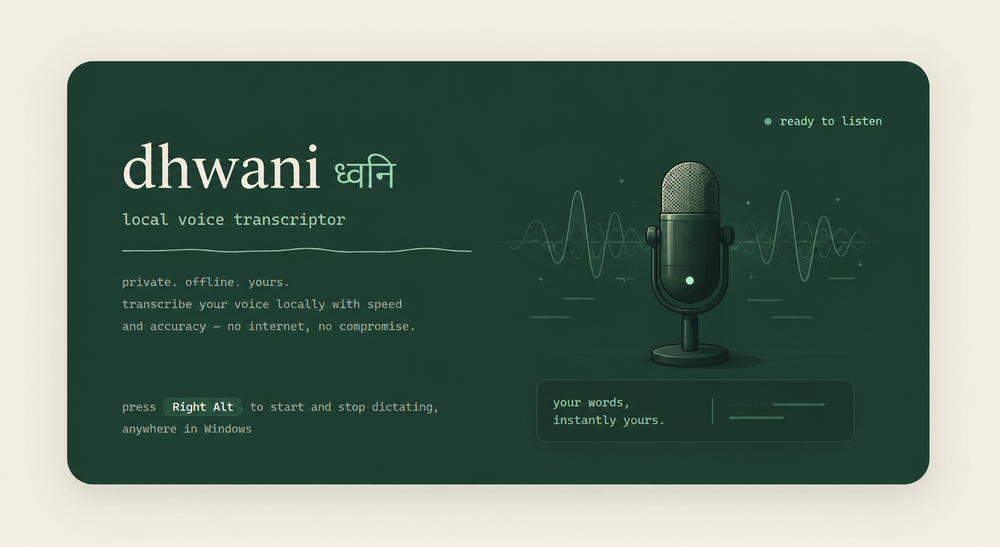

<p align="center">
  
</p>

# dhwani <sub>ध्वनि · "sound"</sub>

Local push-to-talk dictation for Windows. Press **Right Alt**, speak, press
**Right Alt** again — clean text lands wherever your cursor is. Whisper on CPU,
zero cloud, zero LLM, zero subscription.

A minimal open-source take on the [Wispr Flow](https://wisprflow.ai) idea:
the transcription-to-typed-text loop, built from six dependencies and the
Python standard library.

**Your voice never leaves the machine.** No account, no API key, no telemetry.
After the one-time model download you can unplug the internet and it still works.

---

## Install

Two tracks. Pick the first one if you don't write code.

### 🟢 Just want to use it (no coding required)

Full click-by-click walkthrough with every prompt you'll see:
**[docs/INSTALL.md](docs/INSTALL.md)**. The short version:

1. **Install Python.** Open Microsoft Store → search *Python 3.12* → **Get**.
   (Free, no account needed.)
2. **Download dhwani.** On this page click the green **Code** button →
   **Download ZIP**. Right-click the downloaded file → **Extract All**.
3. **Start it.** Open the extracted folder, right-click `run.ps1` →
   **Run with PowerShell**. First run takes a few minutes — it's downloading
   the speech model (~74 MB). Leave it alone until it says *dhwani starting*.
4. **Use it.** Press **Right Alt**, talk, press **Right Alt** again. Your words
   appear wherever your cursor is — Word, Chrome, WhatsApp, anywhere.

If Windows blocks the script, see
[*"running scripts is disabled"*](docs/INSTALL.md#windows-says-running-scripts-is-disabled)
— it's one line to fix and it's the most common snag.

### ⚙️ Developer install

Requires Python 3.10+ on Windows. `run.ps1` installs [uv](https://docs.astral.sh/uv/)
for you if it isn't already on PATH.

```powershell
git clone https://github.com/devanshc777/dhwani.git
cd dhwani
.\run.ps1                              # creates .venv, installs, launches
.\run.ps1 -Background                  # same, but detached (survives closing the terminal)
.\scripts\install-autostart.ps1        # optional: start with Windows (hidden)
```

## How it works

```
Right Alt ──▶ mic capture ──▶ faster-whisper ──▶ rule cleanup ──▶ Ctrl+V inject
          (sounddevice)   (base, int8, CPU)  (fillers, cmds)   (clipboard)
               │                                    │
        waveform overlay                       SQLite history
        (tkinter, no-focus)               web UI @ 127.0.0.1:8770
```

Every stage exchanges plain data (float32 audio in, `str` out). Swap any
stage — OpenVINO whisper on the NPU, an LLM cleanup pass — without touching
the others. The data contract is the architecture.

## Features

- **Right Alt toggle** anywhere in Windows (configurable), debounced against key
  auto-repeat; utterances process strictly in order
- **Floating waveform pill** — a small transparent glow-waveform while
  recording that never steals focus from the app you're dictating into
- **Tuned transcription** — language pinned (auto-detect misfires on short
  clips), in-clip silence filtering (kills "You You… Hi. Hi." hallucinations),
  `initial_prompt` bias so your name and jargon spell correctly
- **Dictionary** — add names, products, and jargon from the web UI; they
  feed the decoder before every utterance and take effect immediately
- **Filler stripping** (um / uh / erm…) + voice commands: say
  *"new line"* / *"new paragraph"* and get exactly that
- **Transcript history** — local web UI at `http://127.0.0.1:8770` with
  cleaned + raw versions and one-click copy
- **Light when idle** — model weights (~300 MB) unload after 30 quiet
  minutes and reload transparently (~2 s) on the next hotkey press
- **Fully offline** after the one-time model download (~74 MB for `base`)

## Coming soon

Not built yet — listed here so nobody installs expecting them.

- **In-app context** 🚧 — dhwani noticing *which* application you're dictating
  into and adapting to it: per-app vocabulary, per-app formatting (code
  identifiers in an editor, prose in a document, short lines in a chat box).
  Today the Dictionary is global — one word list for every app.
- **UI/UX overhaul** 🚧 — the current web UI is a functional first pass. The
  planned version: a proper settings surface (hotkey, model, language editable
  in the app instead of via environment variables), live recording feedback,
  and a tray icon so the app is visible without opening a browser tab.

Both are tracked in [Roadmap](#roadmap) below.

## Configuration (env vars)

| Variable | Default | Notes |
|---|---|---|
| `DHWANI_MODEL` | `base` | `tiny` (fastest) / `base` / `small` (most accurate) |
| `DHWANI_LANGUAGE` | `en` | any whisper code, or `auto` (unreliable on short clips) |
| `DHWANI_PROMPT` | your names/jargon | words the decoder should spell correctly |
| `DHWANI_HOTKEY` | `right alt` | any [`keyboard`](https://github.com/boppreh/keyboard) combo |
| `DHWANI_IDLE_UNLOAD_MIN` | `30` | minutes before model unloads (0 = never) |
| `DHWANI_PORT` | `8770` | web UI port |
| `DHWANI_DB` | `~/.dhwani/transcripts.db` | history location |

Not a coder? You don't need any of these — the defaults are the tested
configuration. Only the key binding is commonly worth changing, and there's a
no-code way to do it below.

### Changing the key binding

The trigger lives on one line, `HOTKEY` in [`dhwani/config.py`](dhwani/config.py):

```python
HOTKEY = os.getenv("DHWANI_HOTKEY", "right alt")
```

Set the `DHWANI_HOTKEY` environment variable (no code change — see
[docs/INSTALL.md](docs/INSTALL.md#changing-the-key-without-touching-code) for
the click-through), or edit the default string.
Any combo the [`keyboard`](https://github.com/boppreh/keyboard) library parses
works: `f8`, `ctrl+win`, `ctrl+shift+d`, `right ctrl`, ... Two notes if you
clone this: bare `Fn` is firmware-level and invisible to the OS, so it can't
be bound; and on AltGr layouts the default `right alt` types accents, so pick
something else.

## Measuring quality (eval harness)

```powershell
# grab any talking-head video's audio + captions as a test set
yt-dlp -x --audio-format mp3 --write-auto-subs --sub-langs en --sub-format vtt -o "sample.%(ext)s" <URL>

# score one config, or compare tiny/base/small x en/auto:
python eval\run.py sample.mp3 --reference sample.en.vtt
python eval\run.py sample.mp3 --reference sample.en.vtt --grid
```

Prints WER (word error rate) + substitution/deletion/insertion breakdown.
Remember auto-captions are themselves ASR — trust the *relative* numbers.
The best reference is you recording yourself reading a known paragraph.

## Design notes

- **No utterance-delimiting VAD.** Push-to-talk toggle means you delimit
  speech. (faster-whisper's *in-clip* `vad_filter` is used though — different
  job: it stops whisper hallucinating text over silent stretches.)
- **No LLM at inference.** Output is a *cleaner transcript of what you said*,
  not a rewrite of what you meant. Instant, private, free.
- **Clipboard paste over synthetic typing.** Survives Electron apps, IMEs and
  RDP; previous clipboard contents are restored afterward.
- **Modifier-release before paste.** The hotkey keys are often still held
  when injection runs; without force-releasing them, Ctrl+V silently becomes
  something else. The kind of bug that costs an evening — see `inject.py`.

## Troubleshooting

Non-coder problems are covered in plain language in
[docs/INSTALL.md](docs/INSTALL.md#when-something-goes-wrong). The short list:

- **"Running scripts is disabled on this system"** — Windows' default script
  policy. Fix in [docs/INSTALL.md](docs/INSTALL.md#windows-says-running-scripts-is-disabled).
- **Nothing happens when I press Right Alt** — the app has to be running.
  Check for the `dhwani` window, or open `http://127.0.0.1:8770`.
- **Output in the wrong language/script** — you're on `DHWANI_LANGUAGE=auto`;
  pin it (`en`). Short clips give detection a coin toss.
- **Names spelled wrong** — add them to the Dictionary in the web UI.
- **Hotkey doesn't fire in elevated apps** — Windows blocks input hooks across
  privilege levels; run dhwani as admin for those.
- **Native wheel blocked by Application Control** — pin one major version
  back (aged wheels have reputation; see `docs/BUILD_LOG.md`).
- **Slow first transcription** — model download/warm-up, or idle reload (~2 s).

## Roadmap

- **in-app context** — per-application vocabulary and formatting (see
  [Coming soon](#coming-soon))
- **UI/UX overhaul** — in-app settings, tray icon, better recording feedback
  (see [Coming soon](#coming-soon))
- OpenVINO / NPU path for Intel Core Ultra machines (same transcriber
  contract, lower power)
- optional local-LLM restructuring pass (opt-in, still offline)

## License

MIT © [Devansh Chowdhary](https://github.com/devanshc777)
