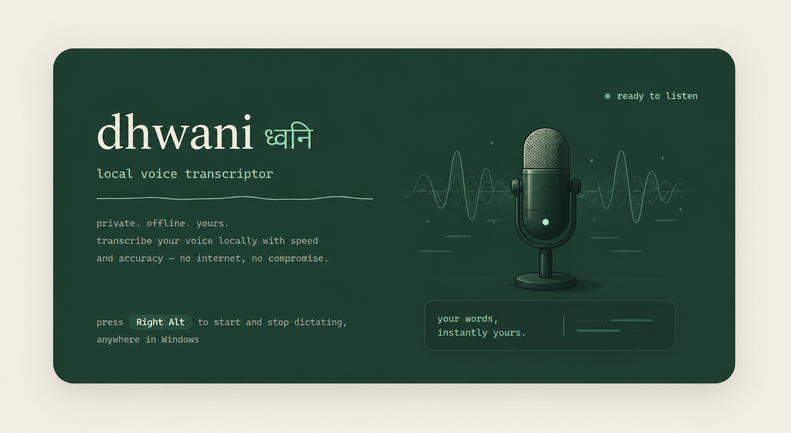

<p align="center">
  
</p>

# Installing dhwani (no coding required)

This page assumes you have never used a terminal and don't want to start now.
Every step is a click, a search box, or a copy-paste. It takes about ten
minutes, most of which is waiting for downloads.

dhwani runs **entirely on your own computer**. Nothing you say is uploaded
anywhere. There is no account to make and nothing to pay for.

**You need:** a Windows 10 or 11 PC, a microphone (a laptop's built-in one is
fine), and about 1 GB of free disk space.

---

## Step 1 — Install Python

Python is the language dhwani is written in. Your PC probably doesn't have it.

1. Open the **Microsoft Store** (click Start, type *Store*, press Enter).
2. In the Store's search box type **Python 3.12**.
3. Click the result published by the *Python Software Foundation* → **Get**.
4. Wait for it to finish. No account or payment is required.

> Downloading from [python.org](https://www.python.org/downloads/windows/)
> works too. If you do, tick **"Add python.exe to PATH"** on the first
> installer screen — it's easy to miss and things break without it.

## Step 2 — Download dhwani

1. Go to **https://github.com/devanshc777/dhwani**
2. Click the green **Code** button near the top right.
3. Click **Download ZIP**.
4. Open your **Downloads** folder, right-click `dhwani-main.zip` →
   **Extract All…** → **Extract**.

You now have a folder called `dhwani-main`. Everything happens inside it.
Move it somewhere you'll remember — your Documents folder is a good spot.

## Step 3 — Start it

1. Open the `dhwani-main` folder.
2. Find the file named **`run.ps1`**.
3. **Right-click** it → **Run with PowerShell**.

A black window opens and text scrolls past. **This is normal.** It is:

- installing the small set of libraries dhwani needs,
- downloading the speech-recognition model (~74 MB, one time only).

The first run can take **3–10 minutes** depending on your internet. Don't close
the window. When it prints something like

```
dhwani starting - Right Alt to dictate - transcripts at http://127.0.0.1:8770
```

you're done. dhwani is listening.

> ⚠️ Keep that black window open. Closing it stops dhwani. To run it without a
> window hanging around, see [Making it always-on](#making-it-always-on) below.

## Step 4 — Dictate something

1. Click into any app where you can type — Notepad, Word, Chrome's address bar,
   a WhatsApp message box. Anywhere.
2. Press **Right Alt** (the Alt key on the *right* side of the spacebar).
   A small glowing waveform appears at the bottom of your screen.
3. Talk normally.
4. Press **Right Alt** again.

A moment later your words appear at the cursor, punctuated and capitalized,
with the *ums* and *uhs* removed.

Say **"new line"** or **"new paragraph"** out loud and you get exactly that
instead of the literal words.

## Step 5 — Teach it your names

Whisper spells common words well and unusual names badly. Fix that once:

1. Open **http://127.0.0.1:8770** in any browser (this page is served by dhwani
   itself, on your own machine — it is not a website).
2. Under **Dictionary**, type a name, product, or bit of jargon → **Add**.
3. That's it. It applies to the very next thing you say.

The same page shows every transcript you've ever dictated, searchable, with a
one-click **copy** button.

---

## Making it always-on

Two upgrades, both optional.

**Run without the black window.** Right-click `run.ps1` → **Run with
PowerShell** works, but leaves a terminal open. Instead, open the folder,
click once in the address bar at the top, type `powershell` and press Enter,
then paste:

```powershell
.\run.ps1 -Background
```

dhwani now runs hidden and survives closing that window.

**Start with Windows.** In the same window, paste:

```powershell
.\scripts\install-autostart.ps1
```

dhwani will start quietly every time you log in. To undo it, run the same
command with ` -Uninstall` on the end. It stays light: after 30 idle minutes it
frees the model's ~300 MB of memory and reloads it in about two seconds the
next time you press the key.

## Changing the key without touching code

Right Alt is the default. On some keyboard layouts (AltGr) that key types
accented characters, and you'll want a different one.

No code editing needed — set an environment variable:

1. Press Start, type **environment variables**, open
   *"Edit the system environment variables for your account"*.
2. Click **New…** under *User variables*.
3. Variable name: `DHWANI_HOTKEY`
4. Variable value: your chosen key, e.g. `f8`, `right ctrl`, `ctrl+shift+d`
5. **OK**, then restart dhwani.

Things worth knowing: the **Fn** key can't be used — it's handled by your
keyboard's firmware and Windows never sees it. Function keys (`f8`) and
combinations (`ctrl+shift+d`) are the safest picks. Any single letter will
fire while you're typing, so avoid those.

---

## When something goes wrong

### Windows says "running scripts is disabled"

The exact message is:

```
run.ps1 cannot be loaded because running scripts is disabled on this system.
```

Windows blocks scripts by default. Allow the ones you run yourself:

1. Click Start, type **PowerShell**, press Enter.
2. Paste this line and press Enter:

   ```powershell
   Set-ExecutionPolicy -Scope CurrentUser RemoteSigned
   ```

3. Type `Y` and press Enter.
4. Go back and right-click `run.ps1` → **Run with PowerShell** again.

This affects only your own user account and does not require admin rights.

### "python is not recognized"

Python didn't install, or didn't get added to PATH. Redo [Step 1](#step-1--install-python)
via the Microsoft Store — that route handles PATH for you. Then close every
PowerShell window and start again (the change only reaches new windows).

### Nothing happens when I press Right Alt

- Is dhwani actually running? Open `http://127.0.0.1:8770`. If the page doesn't
  load, it isn't — redo [Step 3](#step-3--start-it).
- Are you pressing the Alt to the **right** of the spacebar? The left one does
  nothing.
- Are you in an app that runs as administrator (some IT tools, Task Manager)?
  Windows blocks keyboard hooks from reaching those. Right-click `run.ps1` →
  Run with PowerShell **as administrator** if you need it there.

### It types in the wrong language, or invents sentences

dhwani is pinned to English by default, which is the reliable setting. If you
changed `DHWANI_LANGUAGE` to `auto`, change it back — short clips confuse
automatic language detection badly.

If it produces text during silence, you probably have a noisy microphone. Try a
headset mic.

### My name is spelled wrong every time

Add it to the **Dictionary** at `http://127.0.0.1:8770` — see
[Step 5](#step-5--teach-it-your-names).

### The first transcription takes forever

Expected. dhwani loads the model on first use (and again after 30 idle
minutes). It takes roughly two seconds after that.

### Windows Defender / SmartScreen warns about the download

The ZIP comes straight from GitHub and the code is all here to read — nothing
is compiled or hidden. Click **More info → Run anyway** if prompted. If your
workplace uses Application Control, one Python library may be blocked; that
case is written up in [BUILD_LOG.md](BUILD_LOG.md).

---

## What's not built yet

So you don't go hunting for buttons that don't exist:

- **In-app context** 🚧 — dhwani doesn't yet know *which* app you're dictating
  into. The Dictionary is one global list, not per-app, and formatting doesn't
  change between a code editor and a chat box. Planned.
- **UI/UX overhaul** 🚧 — settings (hotkey, model, language) currently live in
  environment variables rather than in the app, and there's no tray icon. The
  web page you get today is a functional first pass, not the final design.

## Uninstalling

1. Run `.\scripts\install-autostart.ps1 -Uninstall` if you set up autostart.
2. Delete the `dhwani-main` folder.
3. Delete the `.dhwani` folder in your user directory (`C:\Users\<you>\.dhwani`)
   — that's your transcript history and the downloaded model.

Nothing is left in the registry, and nothing was ever sent anywhere.
